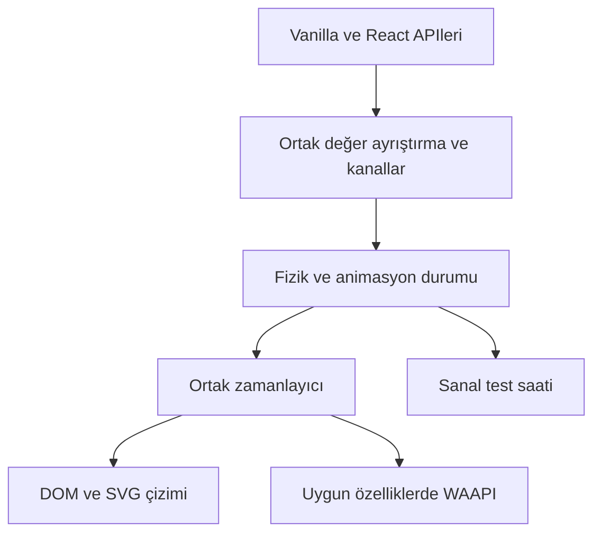

# SpringKit derin proje analizi

Tarih: 8 Kasım 2026. İncelenen sürüm: `2.0.0`, çalışma ağacının tabanı `703be977beb4a12357cf20fa897aa66b79353702`.

SpringKit'in fizik çekirdeği güçlü ve ölçümlerde hızlı. Ürünün önündeki temel engeller, özellik sayısından çok ortak değer işleme eksikliği, farklı animasyon denetleyicilerinin farklı sözleşmeleri, React üzerinden kare başına çizim ve yayın doğrulamasındaki boşluklar. Yeni özelliklerden önce bu alanları sağlamlaştırmak daha yüksek değer taşır.

Bu inceleme üretim kodunu değiştirmedi. Bulgular mevcut kaynak, yeniden derlenen dağıtım, çalıştırılabilir kanıtlar, testler, paket ölçümleri ve yerel tarayıcı kontrollerine dayanır. Öneriler, doğrulanmış hatalardan ayrı tutulmuştur.

## 1. Projenin büyüklüğü ve mevcut ürün

| Alan | Dosya | Boş olmayan satır | Değerlendirme |
| --- | ---: | ---: | --- |
| Kütüphane kaynakları | 88 | 26.398 | Küçük bir yay yardımcısından geniş bir animasyon araç takımına dönüşmüş |
| Testler ve kurulum | 138 | 34.882 | 137 gerçek test dosyası ve bir kurulum dosyası |
| Site kaynakları | 46 | 18.571 | Dokümantasyon, etkileşimli örnekler ve ürün tanıtımı |
| React bağlayıcısı | 45 | 13.327 | Kaynak kodun yaklaşık yarısı; önemli bakım ve performans yüzeyi |
| Ana girişin çalışan dışa aktarımları | 122 | — | Çok geniş bir uzun vadeli uyumluluk yükümlülüğü |
| React girişinin çalışan dışa aktarımları | 124 | — | Ana girişle ortak adlar içerir; iki sayı benzersiz API toplamı olarak toplanmamalı |

Kaynak katmanları:

| Yol | Görev | Güçlü taraf | Öncelikli geliştirme |
| --- | --- | --- | --- |
| `src/core/` | Yay fiziği, değerler, gruplar, varyantlar | Analitik fizik, hız koruyarak hedef değiştirme, sayısal doğrulama | Değer sınıflarının abonelik ve yaşam döngüsü davranışlarını birleştirme |
| `src/animation/` | Döngü, imperative DOM animasyonu, timeline, keyframes, sıra, trail | Tek çekirdek döngü, hata izolasyonu, sanal saatle çalışma | Diğer RAF zincirlerini azaltma; ortak kontrol ve çizim sözleşmesi |
| `src/native/` | Yay eğrisini CSS `linear()` ve WAAPI'ye derleme | Küçük, kullanılabilir, ayrı bir ürün değeri | Tarayıcı performans matrisi ve JS motoruyla kesinti davranışı eşitliği |
| `src/gesture/` | Drag, scroll, pinch, rotate, swipe, long press | Sınırlar, momentum, pointer kimliği, iptal yolları | Core ve React drag katmanlarının ortak hesaplama parçaları |
| `src/interpolation/`, `src/utils/` | Sayı, renk ve matematik | Alfa ön çarpımı, OKLab, sınırlı önbellekler | String/renk işleme mantığının bütün animasyon girişlerinde paylaşılması |
| `src/layout/` | FLIP, paylaşılan layout, otomatik gözlem | Kesinti ve stilleri geri yükleme yolları, yarıçap düzeltmesi | Ortak ölçüm/çizim aşamaları; nested ve scroll'lu layout testleri |
| `src/scroll/` | Scroll progress, trigger, parallax | Smoothing'in input durduktan sonra da hedefe devam etmesi | Ortak listener/gözlemci kullanımı ve native scroll yolu değerlendirmesi |
| `src/svg/` | Yol çizimi ve morph | Yol ayrıştırma ve tarayıcı örneklemesi | Çoklu alt yol, delik ve topoloji sınırlarının açık sözleşmesi |
| `src/testing/` | Sanal RAF, zaman ve isteğe bağlı timer | Paketin en değerli ayrıştırıcı özelliklerinden biri | Yeni testlerde standartlaştırılması; gerçek zaman beklemelerinin azaltılması |
| `src/adapters/react/` | Hook, component, presence, erişilebilirlik, SSR | StrictMode ve SSR için ciddi çalışma yapılmış | MotionValue bağlama, doğrudan DOM çizimi, gerçek tamamlanmaya dayalı olaylar |
| `website/` | Belgeler ve gösterimler | Çalışan ve kapsamlı örnek yüzeyi | Başlangıç paketi, mobil alt menü, ölçümlerin güncel tutulması |

88 kaynak dosyasının statik çalışma zamanı import grafiğinde döngü bulunmadı. Bu, dinamik yükleme veya farklı ESM/CJS tüketici kombinasyonları için ayrı bir garanti değildir.

## 2. Korunması gereken temel kararlar

1. **Analitik yay çözümü.** `src/core/physics.ts`, kritik, az ve fazla sönümlü rejimleri kapsıyor. Fizik sabitleri önceden hesaplanıyor; aynı ayarı kullanan yaylar ortak hesaplamadan yararlanıyor. Çekirdeği yeniden yazmak için bir gerekçe çıkmadı.
2. **Çalışma zamanı bağımlılığı olmaması.** Fizik, gesture, interpolation ve SVG uygulamaları depoda bulunuyor. Ana pakette başka bir animasyon motoruna çalışma zamanı bağımlılığı yok. React isteğe bağlı eş bağımlılık.
3. **Ana paket ile React ayrımı.** React, çekirdeği paket adı üzerinden dış bağımlılık olarak kullanıyor. Böylece aynı modül biçimindeki tüketimde çekirdek iki kez gömülmüyor. `tsup.config.ts` ve `CLAUDE.md` bu kararı açıklıyor.
4. **Çalışan animasyonların güçlü referansla tutulması.** `src/animation/loop.ts`, kontrol nesnesi saklanmayan animasyonların erken toplanmasını önlüyor. README'deki WeakRef anlatımı güncel uygulamayı doğru tarif etmiyor; çözüm güçlü referansı kaldırmak değil, anlatımı düzeltmek.
5. **Sanal test saati.** Kullanıcıların animasyonlarını kendi testlerinde deterministik çalıştırabilmesi, yalnızca daha fazla preset sunmaktan daha kalıcı bir ürün değeri.
6. **Paket dağıtımı.** ESM/CJS ve bunlara uygun `.d.ts`/`.d.cts` çıktıları, `use client` işareti, optional React peer ve paket dosya izin listesi iyi düşünülmüş.
7. **Regresyon kültürü.** Çok sayıda önceki hata için kalıcı test var. Yüksek kapsam oranına rağmen yeni davranış hatalarının çıkması, bundan sonraki testlerin ağırlığını çapraz API sözleşmelerine vermek gerektiğini gösteriyor.

## 3. Doğrulanmış davranış hataları

Kanıtlar `.temp_files/deep-analysis-2026-11-08/` altında. `probe.mjs` ilk beş hatayı, diğer dosyalar ayrı React ve tip hatalarını yeniden üretiyor. Toplam sekiz başarısız davranış/tip örneği var; yüzde birimi ve renk sorunu aynı sayısal string dönüşümünden kaynaklanıyor, dolayısıyla yedi kök neden grubu olarak ele alınmalı.

### D01 — Yüksek oynatma hızında fizik saati tutarsızlaşıyor

- **Yer:** `src/animation/loop.ts:332`, `src/core/spring.ts:261`.
- **Tetikleyici:** `globalLoop.setTimeScale(10)` ile yay çalıştırmak.
- **Beklenen:** 10× hızda 100 ms ile 1× hızda 1.000 ms aynı animasyon durumunu üretmeli.
- **Gözlenen:** 1× sonuç `100.21701167393262`; 10× sonuç `115.31227684140492`. Kontrol olan 2×/500 ms, 1× sonucuyla eşleşiyor.
- **Kök neden:** Döngü gerçek delta'yı sınırlayıp hızla çarpıyor; yay bu ölçeklenmiş süreyi yeniden yaklaşık 66,7 ms ile sınırlıyor. Hız arttığında animasyon saatinin bir kısmı fizikte kayboluyor.
- **Etki:** Hızlı oynatma, timeline/delay ve fizik arasındaki eşzamanlılığı bozabilir. Düşük hızların testi bu sınırı yakalamıyor.
- **Öneri:** Askıdan dönme sınırlamasının sahibini tekleştirmek; 0, 0.1, 1, 2, 5, 10× için eşdeğer animasyon zamanı testleri eklemek.

### D02 — MotionValue abonelikleri birbirinin kaydını silebiliyor

- **Yer:** `src/core/MotionValue.ts:237`.
- **Tetikleyici:** Aynı fonksiyonu iki kez `subscribe()` ile kaydedip ilk abonelikten çıkmak.
- **Beklenen:** İkinci abonelik çalışmaya devam etmeli.
- **Gözlenen:** Sonraki güncellemede çağrı sayısı `0`; beklenen `1`. Aynı senaryodaki `SpringValue` kontrolü `1` üretiyor.
- **Kök neden:** Callback doğrudan `Set` anahtarı. Abonelik başına ayrı kayıt kimliği yok.
- **Etki:** Paylaşılan dinleyici kullanan bağlama katmanlarında bir temizleme, başka tüketicinin güncellemelerini kesebilir.
- **Öneri:** `SpringValue` ve `SpringGroup` içindeki abonelik başına sarmalayıcı yaklaşımını ortaklaştırmak. Eski unsubscribe handle'ının sonradan yapılan kaydı silemediği de test edilmeli.

### D03 — MotionValue sayısal durumu NaN olabiliyor

- **Yer:** `src/core/MotionValue.ts:195`; anlık `set()` yolu da `:172` üzerinden aynı doğrudan atama desenini kullanıyor.
- **Tetikleyici:** `createMotionValue(1).jump(NaN)`.
- **Beklenen:** Kütüphanenin diğer sayısal değer katmanlarıyla tutarlı, sonlu durum.
- **Gözlenen:** `MotionValue.get()` → `NaN`; `SpringValue.jump(NaN)` kontrolü → `0` ve geliştirme uyarısı.
- **Kök neden:** İç yay doğrulansa bile dış `_value` ham argümanla atanıyor.
- **Etki:** Türetilmiş değerler ve DOM stilleri geçersiz değer alabilir.
- **Öneri:** Generic string değerler korunarak sayısal değerlerin kurucu, jump ve anlık set girişlerinde ortak doğrulamadan geçirilmesi.

### D04 ve D05 — Imperative animate birim ve renk bilgisini kaybediyor

- **Yer:** `src/animation/animate.ts:309`, `:368`, `:147`.
- **Tetikleyiciler:** `animate(el, { width: '50%' })` ve `animate(el, { backgroundColor: '#0000ff' })`.
- **Gözlenen:** Yüzde hedefi sonunda `50px`; kırmızıdan maviye renk hedefinde son değer hâlâ `rgb(255, 0, 0)`.
- **Kontroller:** Sayısal width hedefi `50px`, sayısal opacity hedefi `1` olarak doğru tamamlanıyor.
- **Kök neden:** Public hedef tipi string kabul ediyor, fakat tüm stringler `parseFloat()` ile sayıya çevriliyor. Boyutlar daha sonra sabit `px` eki alıyor; renk stringi `0` oluyor ve geçerli renk olarak uygulanamıyor.
- **Etki:** Aynı kütüphanede React `Animated` ile çalışan değer, imperative `animate` ile farklı sonuç verebiliyor.
- **Öneri:** React içindeki `parseAnimatableValue` / kanal / template yaklaşımını framework bağımsız bir katmana taşımak; DOM property metadata'sını da paylaşmak. Desteklenmeyen stringlerin sessizce `0` olması engellenmeli.

### D07 — LazyMotion yükleyicisi değişirken önceki özellikler yüklü kalıyor

- **Yer:** `src/adapters/react/components/LazyMotion.tsx:156`, `:195`.
- **Tetikleyici:** İlk async loader tamamlandıktan sonra henüz tamamlanmamış ikinci loader'a geçmek.
- **Beklenen:** Kaynaktaki sözleşmeye göre yeni loader beklenirken `isLoaded: false`; özellikler kullanılamaz.
- **Gözlenen:** `isLoaded: true, gestures: true` kalıyor. İkinci loader tamamlandığında `gestures: false` oluyor.
- **Kontrol:** İlk loader'ın tamamlanmış durumu doğru, ikinci loader'ın son durumu da doğru.
- **Kök neden:** Async sonuç ve loaded durumu loader kimliğine bağlı tutulmuyor.
- **Öneri:** Sonucu loader/generation kimliğiyle saklamak; önceki loader'ın tamamlanması ve yeni loader'ın bekleme durumunu ayrı sözleşmelerle test etmek. Kanıt açıkça kontrol edilen Promise kullanır; gerçek zaman beklemez.

### D08 — Varyant tamamlanma olayı gerçek yay durmadan geliyor

- **Yer:** `src/adapters/react/hooks/useVariants.ts:41`, `:352`, `:355`.
- **Tetikleyici:** `stiffness: 60, damping: 6` ile x'i 0'dan 1.000'e götürmek.
- **Beklenen:** `onAnimationComplete` gerçek animasyonun dinlenme durumundan sonra gelmeli.
- **Gözlenen:** Olay yaklaşık 2.316,67 ms'de, x `1001.0377358323697` iken geliyor. Sonraki 100 ms'de x `1000.3126923193195` oluyor: tamamlandı bildirildikten sonra yaklaşık `0.725 px` hareket sürüyor.
- **Kontrol:** Aynı ayarla 0→1 animasyonunda olay x `1` iken geliyor ve sonrasında hareket yok.
- **Kök neden:** Tamamlanma, gerçek grubun bitişinden değil birim mesafe için tahmin edilen settle süresinden türetiliyor. Gerçek mesafe, mutlak eşikler ve kesinti bu tahminle uyuşmayabiliyor.
- **Etki:** Tamamlanma sonrası başlatılan işlerin erken çalışması, orkestrasyon sırasının bozulması.
- **Öneri:** Mevcut hedefin/generation'ın gerçek `finished` durumuna bağlanmak. Aynı isimde varyantın değer değiştirmesi ve hareket sırasında yeniden hedeflenmesi de kapsanmalı.

### D09 — Animated SVG elemanlarının ref tipleri yanlış

- **Yer:** `src/adapters/react/components/Animated.tsx:240`, `:969` ve aynı dosyanın SVG dışa aktarımları.
- **Tetikleyici:** `<Animated.svg ref={React.createRef<SVGSVGElement>()} />` veya `Animated.path` için `SVGPathElement` ref'i.
- **Beklenen:** Sunulan SVG bileşeni kendi gerçek DOM elemanı tipini kabul etmeli.
- **Gözlenen:** Derlenmiş paketi kullanan TypeScript tüketicisi iki örnekte de `TS2322` veriyor; beklenen ref tipi `HTMLElement`. Aynı dosyadaki `Animated.div`/`HTMLDivElement` kontrolü hata vermiyor.
- **Kök neden:** Generic tag'in ref tipi korunmayıp `RefAttributes<HTMLElement>` ile sabitleniyor.
- **Öneri:** Ref'i tag'in gerçek element tipinden türetmek; HTML ve SVG için tüketici tip testleri eklemek. `publint`/`attw` paket çözümlemesini doğruluyor, bu tür kullanım hatalarını yakalamıyor.

### Hata olarak raporlanmayan sınır

`solveSpring({ damping: 0 })` için 10 saniyede hedefe geçiş gözlendi. Ancak `src/native/solver.ts` süreyi açıkça 10 saniyeyle sınırlıyor. Bunu yeni hata saymadım. Uzun/sonsuz fizik ile sonlu bir CSS eğrisi arasındaki ayrım belgelerde daha görünür yapılabilir.

## 4. Performans ölçümleri ve anlamları

### Fizik ve değer takibi

`npm run bench`; Node `26.13.0`, 300 kare, beş denemenin en iyi ortalaması. Makine üzerindeki diğer işlerin etkisi tamamen dışlanmadı; bunlar yerel karşılaştırmalar, cihaz veya tarayıcı FPS garantisi değildir.

| Yol | 100 değer ms/kare | 1.000 değer ms/kare | 10.000 değer ms/kare |
| --- | ---: | ---: | ---: |
| `spring().start()` | 0.004 | 0.040 | 0.327 |
| Farklı fizik ayarlarıyla `spring()` | 0.005 | 0.038 | 0.343 |
| `SpringValue`, iki abone | 0.006 | 0.075 | 1.201 |
| `MotionValue.set()` | 0.013 | 0.132 | 3.701 |

`MotionValue.set` yeniden hedefleme: `0.170 µs/çağrı`; anlık set: `0.028 µs/çağrı`; `solveSpring()`: `49.664 µs/çağrı`.

**Çıkarım:** Önce trigonometrik hesapları optimize etmeye devam etmek yerine üst katmanların bildirim, RAF ve çizim maliyetine odaklanmak daha anlamlı. Aynı benchmark'ta 10.000 MotionValue yolu, ham yay yolundan yaklaşık 11 kat pahalı; bu farkın tamamı tek bir mekanizmaya atfedilemez.

Bağımsız yapısal ölçüm: 100 ham yay **1** bekleyen RAF callback'i; 100 animasyonlu MotionValue **101** callback. `MotionValue.ts:140` bitişi değer başına ayrı RAF ile yokluyor. Tamamlanma bildiriminin yaydan gelmesi bu ek işi azaltmak için somut bir aday.

### React çizimi

`react-render.mjs`, React Profiler ve sanal saatle tek `Animated.div` için 12 animasyon karesinde 12 ek commit ölçtü. `Animated.tsx:590` içindeki `showState` her değişimde React state güncelliyor; `useSpring` de güncel sayıları state üzerinden veriyor.

Bu kendi başına her kullanımda yavaşlık kanıtı değildir. Ancak yüzlerce animasyonlu elemanda ölçeklenme açısından önemli bir tasarım maliyetidir. MotionValue için mevcut doğrudan DOM aboneliği önerisi, React bileşeninin kendisine de uygulanabilir. React Spring'in animated elemanları da değerleri React render'ı oluşturmadan DOM'a uygular. [React Spring resmi açıklaması](https://www.react-spring.dev/docs/concepts/animated-elements).

Önerilen ayrım:

- React: mount/unmount, hedefler, gesture durumu, presence ve erişilebilirlik.
- Değer motoru: fizik, hız, kesinti ve tamamlanma.
- DOM renderer: her karede stil ve attribute yazımı.
- React state: kullanıcı özellikle render içinde canlı sayısal değer istiyorsa.

### Gerçek tüketici paket boyutları

Yeniden üretilen ESM çıktıları esbuild ile browser için bundle+minify edildi; React ve ReactDOM dışarıda bırakıldı. Gzip Node `gzipSync` varsayılanıyla hesaplandı. Aşağıdaki KB ondalıktır, 1 KB = 1.000 byte.

| Tüketim | Minify byte | Gzip byte | Gzip KB |
| --- | ---: | ---: | ---: |
| Yalnız `spring` | 10.537 | 3.594 | 3.59 |
| Yalnız `animateNative` | 9.352 | 3.754 | 3.75 |
| Yalnız `createMotionValue` | 16.032 | 4.674 | 4.67 |
| `Animated.div` | 65.194 | 22.658 | 22.66 |
| Ana girişin tamamı | 113.192 | 37.537 | 37.54 |
| React girişinin tamamı, kullanılan core dahil | 174.265 | 58.062 | 58.06 |
| Ana ve React girişlerinin tamamı birlikte | 217.905 | 72.182 | 72.18 |

Tree shaking çalışıyor: yalnız spring tüketimi bütün core'dan belirgin küçük. Bununla birlikte README'nin `Animated ~16 KB`, core `~31 KB` rakamları mevcut ölçümle örtüşmüyor. Tam karşılaştırma scripti ve kullanılan sürümler depoya alınmalı, site/README rakamları aynı çıktıyla üretilmeli. Bu incelemede rakip paketler aynı ortamda yeniden ölçülmedi; eski rakip rakamlarıyla yeni sıralama yapılmadı.

Npm paketi: 18 dosya, sıkıştırılmış `364.296 byte`, açılmış `1.600.436 byte`. Bu kurulum arşivi büyüklüğüdür; tarayıcıya giden tree-shaken bundle ile karıştırılmamalı.

## 5. Mimariyi nasıl daha iyi hale getirebiliriz

### Ortak değer ve stil işleme

Şu anda imperative animate, timeline, React Animated, variants ve scroll-linked yolları farklı değer/stil işleme kuralları kullanıyor. Bunun sonucu yalnız kod tekrarı değil, D04/D05 gibi farklı gözlenen davranışlar.

Önerilen yapı:



Ortak katman sayısal değer, birimli string, renk ve karmaşık string template'ini tanımalı. CSS property metadata'sı birimsiz sayılar, px ve transform birimlerini ayırmalı. Mevcut React parser'ı iyi başlangıç; core'a taşınırken React bağımlılığı almamalı. Birimleri farklı iki string arasında mevcut anlık geçiş davranışı açıkça korunmalı veya ayrı bir geliştirme olarak ele alınmalı.

### Ortak zamanlayıcı ve kaynak sahipliği

`globalLoop` tek başına iyi; üst katmanlarda kendi RAF zincirleri, bitiş yoklamaları ve DOM işi bulunuyor. Tekleştirme, tüm kodu tek büyük dosyaya taşımak anlamına gelmemeli. Okuma/ölçüm, fizik güncellemesi, stil yazımı ve kullanıcı bildirimi için açık aşamalar sunulabilir.

Her animasyon çalışması için ortak kurallar tanımlanmalı:

- Hedefi hangi çalışma/generation yönetiyor?
- Durdurma `finished` sonucunu nasıl etkiliyor?
- Kullanıcı callback'i yeniden animasyon başlatırsa hangi çalışma kazanıyor?
- Pause sırasında zaman ve bekleyen gecikmeler ne yapıyor?
- Destroy sonrası hangi metotlar no-op, hangileri hata?

Önce mevcut denetleyicilere adapter ve ortak iç sözleşme eklenmeli. Public `start/play/stop/cancel/kill/destroy` adlarının bir anda değiştirilmesi gereksiz kırıcı değişiklik oluşturur.

### Native ve JS motorunu ürün olarak birleştirme

`animateNative` bugün açık bir alternatif. Sonraki aşamada uygun transform/opacity animasyonları için `engine: 'auto' | 'js' | 'native'` gibi açık seçim değerlendirilebilir. Otomatik seçimden önce retarget, velocity, reverse, cancel, persist ve reduced-motion davranışları iki motorda karşılaştırılmalı.

CSS `linear()` desteği ile animasyonun gerçekten compositor'da çalışması aynı garanti değildir. Motion kendi API'sini de “desteklendiğinde” donanım hızlandırmalı olarak tarif ediyor. WebKit'te linear/threaded animation davranışı için açılmış ve ana dalda düzeltilmiş kayıtlar bulunuyor; bu kayıtlar belirli bir kullanıcının Safari sürümünün sonucu yerine geçmez. [Motion animate](https://motion.dev/docs/animate), [WebKit 312407](https://bugs.webkit.org/show_bug.cgi?id=312407), [ilgili düzeltme kaydı](https://bugs.webkit.org/show_bug.cgi?id=312015).

## 6. API tutarlılığı ve fazla yüzey

| Konu | Mevcut durum | Öneri |
| --- | --- | --- |
| Zaman birimi | Genel API'de ms, timeline'da saniye, Trail followDelay'de 60 Hz referans kare | 2.x'te açık birim tabloları ve isimler; içte tek birim; olası public birleşim ancak major sürümde |
| Tamamlanma | Spring/animate'de finished; keyframes/path'te play Promise; timeline'da farklı kontroller | Ortak çalışma sonucu ve iptal nedeni için geriye uyumlu iç sözleşme |
| Değer kapsamı | Animated geniş string desteği; animate stringi sayıya indirger; timeline sayısal | Destek matrisi ve ortak parser; sessiz kabulden kaçınma |
| `animate.getProgress()` | Çalışan özellik başına 0.5, duran başına 1 ortalaması | Gerçek zaman/playhead ilerlemesiyle karıştırılmamalı; API'nin amacı netleştirilmeli |
| `animate.duration/ease` | Tipte var; incelenen implementation bu değerlerle tween üretmiyor | Gerçek destek ekleme ya da açık deprecation; etkisiz parametre bırakmama |
| `LazyMotion` | Özellik bayraklarını dağıtır; Animated bunu okumaz, kendi başına kod bölmez; strict no-op | Mevcut açıklamayı koruma; gerçek feature loader olacaksa ayrı implementasyon, aksi halde daha açık adlandırma |
| Scroll momentum ayarları | `gesture/scroll.ts` içinde etkisiz ve deprecated olarak işaretli | 2.x'te kaldırmama; sonraki major temizliğinde çıkarma |
| Gravity `mass` | Dışa açık seçenek, `_mass` ile kullanılmıyor | Fiziğin amacına göre açıklama veya deprecation; yerçekimi ivmesi için kütleye bağlılık vaat edilmemeli |
| Physics yardımcıları | Analitik `stepSpring` yanında public Euler `simulateSpring` | Farklarını ve kullanım amacını netleştirme; aynı hassasiyetteymiş gibi sunmama |
| Public yardımcılar | Renk dönüşümü, transform üretimi, validation, context ve çok sayıda hook | Stable, advanced, internal ayrımı; public'ten silmeden kullanım ve sürümleme planı |

“Fazla” olanın temel ölçütü dosya sayısı değil, birbirini tekrar eden ve farklı davranan sözleşmeler. Magnetic, TiltCard, TypeWriter, gyroscope gibi hazır efektler kullanılabilir ürün parçaları; çekirdek geliştirmesini yavaşlatıyorlarsa ayrı recipe/advanced girişine taşınmaları değerlendirilebilir. Kullanım verisi olmadan bunları silmek doğru olmaz.

Kaynakta 1.000 satır civarında büyümüş dosyalar var: `Animated.tsx` 1.048, `usePhysics.ts` 1.226, `useTransform.ts` 1.074, `timeline.ts` 955 toplam satır. Sorumluluklara göre ayrıştırma yararlı olur; ortak altyapı kurulmadan yalnızca dosya bölmek davranış tekrarını çözmez.

## 7. Testlerin güçlü tarafı ve açıkları

### Gerçek sonuçlar

| Kontrol | Sonuç |
| --- | --- |
| `npm run typecheck` | Geçti; kaynak ve tests TypeScript kontrolleri |
| `npm run lint` | Geçti |
| `npm run build` | Geçti; ESM, CJS ve declaration çıktıları |
| `npm run lint:package` | Geçti; publint strict ve attw bütün girişlerde sorunsuz |
| Geçici dosyalar dışlanmış ana suite + coverage | 137 dosya, 2.718 test geçti |
| React konfigürasyonu + ek coverage | 58 dosya, 1.036 test geçti |
| Website typecheck | Geçti |
| Website production build | Geçti; büyük başlangıç chunk uyarısı var |
| `git diff --check` | Geçti |

Ana suite komutu:

```text
node node_modules/vitest/vitest.mjs run --coverage --exclude '**/.temp_files/**' --maxWorkers=2 --minWorkers=1
```

React ölçüm komutu:

```text
node --max-old-space-size=4096 node_modules/vitest/vitest.mjs run --config vitest.config.react.mts --exclude '**/.temp_files/**' --coverage --coverage.provider=v8 --coverage.reporter=json-summary --coverage.reporter=text --coverage.reportsDirectory=.temp_files/deep-analysis-2026-11-08/react-coverage
```

**2.718 + 1.036 benzersiz test değildir.** Ana konfigürasyon React testlerini de seçiyor; React suite bunun alt kümesini ikinci konfigürasyonla tekrar çalıştırıyor. `CLAUDE.md` içindeki “core only” açıklaması konfigürasyonla uyuşmuyor.

### Kapsam

| Alan | Satır/statement | Branch | Function |
| --- | ---: | ---: | ---: |
| Ana coverage kapsamı, React hariç | %97.71 | %90.19 | %98.14 |
| React adapter, 45 dosyanın ağırlıklı toplamı | %95.14 | %95.51 | %94.37 |

Ana konfigürasyon React'i coverage hesabından çıkarıyor. React konfigürasyonunda kendi include/exclude/threshold sınırları yok; ham “All files %17.53” raporu site, script ve denetim dosyalarını da kapsadığı için React kapsamı değildir. Yukarıdaki React sayısı yalnız `src/adapters/react/` dosyalarının covered/total toplamından hesaplandı. Kalıcı bir React kapsam kapısı eklenmeli.

### Standart test komutundaki sorun

`npm run test:coverage` değiştirilmeden çalıştırıldığında 205 dosya seçildi: **62 dosya başarısız, 143 dosya başarılı; 36 test başarısız, 2.763 test başarılı**. Başarısız dosyalar arasında sıfır test toplayan geçici dosyalar da var; 62 dosya sayısı 62 ürün hatası değildir.

`.temp_files` içindeki önceki kanıtlar eski kod kopyalarını da çalıştırıyor. `vitest.config.ts:8` bunları dışlamıyor. Ayrıca yüksek eşzamanlılık ve coverage yükü altında gerçek zaman bekleyen birkaç kalıcı test de başarısız oldu. Aynı kalıcı testlerin tamamı iki worker ile sınırlandırılmış, geçici dosyaların dışlandığı suite'te geçti. Bunları yeni deterministik ürün hatası olarak raporlamadım.

Öneriler:

1. Test seçimini `tests/**/*` ile açıkça sınırlamak ve geçici kanıtları dışlamak. Eski kanıtları silmek çözümün gereği değil.
2. Ana/core ve React suite'lerinin çakışmasını bilinçli tasarlamak; iki konfigürasyon gerekiyorsa bunu açıkça belgelemek.
3. `setTimeout`/`wait` eşleşmesi bulunan 104 test satırını gözden geçirmek; animasyon ilerletme amaçlı olanları sanal saate taşımak. 104 sayısı 104 ayrı flaky test anlamına gelmez.
4. Sayısal kapsamı artırmaktan önce aynı sözleşmeyi SpringValue, MotionValue, Animated ve animate üzerinde çalıştıran test tabloları yazmak.
5. Gerçek Chromium/Firefox/WebKit testleri: pointer capture/lost capture, touch scrolling, nested drag, scroll container, SVG geometri, FLIP, CSS linear ve WAAPI.
6. React 18 ve 19 için tüketici matrisi. Yerel ana suite React `19.2.3` ile çalıştı; React 18 desteği bu koşudan çıkarılamaz.
7. Gerçek paket tüketicisi fixture'ları: Vite, ESM, CJS, TypeScript NodeNext ve bundler, Next App Router, React olmayan kullanım. Kaynak alias'lı testler tek başına yayımlanan çıktının bütün kullanımını doğrulamaz.

## 8. Yayın ve bağımlılık sağlığı

### Yayın sırası

`.github/workflows/release.yml:39` içinde publish, `:43` içindeki `lint:package` kontrolünden **önce** çalışıyor. `prepublishOnly` tip/lint/build/test çalıştırıyor fakat paket uyumluluk kontrolünü içermiyor. Bozuk export/declaration yapısı npm'e çıktıktan sonra fark edilebilir.

Önerilen sıra: temiz kurulum → typecheck/lint → build → test → paket doğrulama → paket tüketici kontrolü → publish. Tag/sürüm eşleştirme ve provenance mevcut; bunlar korunmalı. Bu analiz yayın işlemi yapmadı ve mevcut yayımlanmış sürümü değiştirmedi.

CI matrisi Node 22/24 ve Ubuntu/Windows içeriyor; engine alanı Node >=18 diyor. Destek sözü güncellenmeli veya 18/20 için uyumluluk kanıtı eklenmeli. CI'da coverage komutu çalışmıyor; threshold'lar normal `test` sırasında kalite kapısı oluşturmuyor. Website job'ında da ayrı typecheck adımı yok.

### Registry advisory eşleşmeleri

8 Kasım 2026 tarihli `npm audit --json` çıktısı:

| Kurulum ağacı | Eşleşen paket kaydı | Kritik | Yüksek | Orta | Düşük |
| --- | ---: | ---: | ---: | ---: | ---: |
| Ana geliştirme ağacı | 26 | 3 | 8 | 14 | 1 |
| Website ağacı | 12 | 0 | 9 | 2 | 1 |

Bu sayılar benzersiz açık sayısı değildir; zincir üzerindeki aynı advisory birden çok paket kaydına yansıyabilir. Ana paketin geliştirme araçları npm tüketicisine çalışma zamanı bağımlılığı olarak gitmez.

Ana ağaçtaki kritik etiketler `vitest`, `tinypool` ve `@vitest/coverage-v8` zincirinde. Kurulu Vitest `2.1.9`. Doğrulanan üretici duyurusu, Vitest UI/Browser Mode veya API sunucusunun belirli koşullarda erişilebilir olmasını gerektiriyor; burada kullanılan `vitest run` bu saldırı yüzeyinin canlı kanıtı değildir. [Vitest üretici güvenlik duyurusu](https://github.com/vitest-dev/vitest/security/advisories/GHSA-5xrq-8626-4rwp).

Website tarafında Vite/PostCSS/Rollup geliştirme zinciri ve React Router kayıtları var. Site statik, BrowserRouter tabanlı bir SPA; listelenen SSR/RSC/server advisories'nin tamamının bu dağıtımda çalıştığı söylenemez. Yama planı gerçek resolved sürümler ve kullanılan yollar üzerinden yapılmalı. Otomatik `npm audit fix --force` bir iyileştirme planı değildir; test ve araç konfigürasyonunu kırabilir. Bu inceleme bağımlılık güncellemedi veya exploit çalıştırmadı.

İki farklı website lock dosyası (`package-lock.json`, `bun.lock`) var, CI npm kullanıyor. Desteklenen kurulum yolu belirlenmeli ve diğer lock dosyasının rolü açıklanmalı.

## 9. Dokümantasyon ve örnek sitesi

### Belgelerde tutarlılık

- `docs/SPECIFICATION.md` hâlâ 1.0.0 ve bütün paket için <5 KB hedefini içeriyor. `docs/IMPLEMENTATION.md` bazı bölümlerde eski Euler uygulamasını tarif ediyor. Bunlar güncel sözleşme olarak kullanılmamalı; tarihsel tasarım olarak işaretlenmeli veya yenilenmeli.
- README'nin WeakRef anlatımı `globalLoop`'un güçlü Set uygulamasıyla çelişiyor.
- Boyut rakamları mevcut ölçümlerle güncellenmeli; rakip karşılaştırmaları sürüm, import biçimi, gzip yöntemi ve ölçüm scriptiyle tekrarlanabilir olmalı.
- README'deki %95+ kapsam ifadesi satır kapsamı için destekleniyor; her metrikte %95 olduğu anlamına gelmiyor.
- `useReducedMotion` içindeki `{ duration: 0 }` örneği SpringConfig'te olmayan bir alan öneriyor. JSDoc ve sitedeki kod bloklarını derlemek bu tür drift'i yakalayabilir.
- `usePhysics` örneklerinde normal DOM için `style={{ y: value.get() }}` gibi canlı bağlama sağlamayan kullanımlar var. Normal div'in `y` stili transform üretmez, `.get()` de tek başına abonelik kurmaz. Çalışan, temizleme yapan binding örneği veya yeni renderer API'si gösterilmeli.
- Son 103 hata düzeltmesini içeren commit ile changelog'un Unreleased alanı eşleştirilmeli; kaynak değişikliklerinin yayımlanmış 2.0.0'da bulunduğu varsayılmamalı.

### Site performansı ve bakım

Website üretim derlemesi ana JS chunk için **771,50 KB minify / 222,00 KB gzip** üretti. Bu bir Lighthouse ölçümü değildir; yine de boş bir paket dokümantasyonu için ilk yükleme maliyeti iyileştirmeye açık.

`website/src/App.tsx:4` ve devamında dokümanlar eager import ediliyor, yalnız örnek sayfaları lazy. Ana sayfanın büyük demo kodu ile bütün dokümanların başlangıçta aynı entry'ye girmesini azaltmak ilk adımdır. `Home.tsx` 2.423, `Examples.tsx` 5.712 toplam satır: ortak demo bileşenleri ve rota bazlı parçalar bakım maliyetini düşürebilir.

Sitedeki bundle kopyalama scripti işlevsel; build yeni dist'i kopyalıyor. Ancak kopyalar Git'te de tutuluyor. Geliştirme sırasında yanlışlıkla eski kopyanın kullanılmasını önleyen hash/üretim politikası veya kaynak alias'ı değerlendirilmeli. Bu incelemedeki website build'i yeni kütüphane çıktısıyla yapıldı; tracked public kopyalar sonrasında byte düzeyinde eski hâline getirildi ve değişmedikleri doğrulandı.

### Mobil ve erişilebilirlik

Kaynak incelemesinde Sidebar `hidden lg:block`; mobil header menüsü yalnız ana bölümleri listeliyor. Küçük ekranda doküman alt başlıklarına ulaşmak için eşdeğer bir içerik menüsü gerekli. Menü düğmesine `aria-expanded` ve `aria-controls`, menüye kapanma/focus davranışı eklenmesi değerlendirilmeli. Mobil viewport bu incelemede çalıştırılmadı; bu bulgular kaynak incelemesine dayanıyor.

Kütüphanede reduced-motion ve Reorder klavye kontrolleri mevcut. Bunları yeniden yapılacak eksikler gibi saymak yanlış olur. Buna karşılık SpringText/TypeWriter ve Reorder animasyonlarının da genel hareket tercihiyle tutarlı davranıp davranmadığı için ürün düzeyinde politika ve gerçek yardımcı teknoloji kontrolü gerekiyor. Metin animasyonu, okuma sırası, kopyalama, grapheme ve RTL ile birlikte değerlendirilmelidir.

### Yerel tarayıcıda gözlenenler

Chromium tabanlı uygulama tarayıcısında yeni production build ile ana sayfa, örnek listesi, Native Springs, Drag, SVG Morph ve Getting Started açıldı. Native demo Run düğmesi çalıştırıldı. Drag örneğinde gerçek sürükleme sonrası offset `123,31 px`, drag start/end ve hız bildirimleri görüldü. SVG örneğinde Star seçimi şekil sayacını artırdı. Kontrol edilen native/drag/SVG akışlarında warn/error console kayıtları görülmedi.

Bu, masaüstünde temel çalışma kontrolüdür. Safari/Firefox eşdeğerliği, bütün örnekler, mobil/touch, compositor thread performansı veya production hosting için sonuç çıkarılmadı.

## 10. Ürün konumlandırması ve gerçekten eksik olanlar

SpringKit'i “rakiplerde olan her özelliği ekleyen paket” olarak büyütmek maliyetli. Daha güçlü odak: **bağımlılıksız fizik çekirdeği, test edilebilir animasyon ve hem JS hem native yaylar**. Exact solver, perceptual duration/bounce ve sanal saat birlikte anlamlı bir paket oluşturuyor.

Bugünkü piyasada salt yay, scroll, layout veya native animasyon sunmak tek başına benzersiz değil. Motion'un resmi dokümanları mini/hybrid animasyon, layout ve view transition akışlarını; React Spring ise SpringValue ve render oluşturmayan animated bağlamasını sunuyor. Bu, özellik listesi karşılaştırmasından çok sözleşme, ölçüm ve kullanım kolaylığında ayrışmak gerektiği çıkarımını destekliyor. [Motion animate](https://motion.dev/docs/animate), [Motion layout](https://motion.dev/docs/layout-animations), [Motion view animations](https://motion.dev/docs/animate-view), [React Spring](https://www.react-spring.dev/docs/concepts/animated-elements).

Öncelikli eksikler:

1. Hangi API'nin hangi değer tipini, zaman birimini ve kontrol işlemini desteklediğini gösteren tek bir destek matrisi.
2. MotionValue'yu HTML/SVG stiline temizleme ile bağlayan küçük ve güvenilir renderer.
3. Gerçek tamamlanma ve iptal sonucunu ortaklaştıran iç animasyon sözleşmesi.
4. Gerçek tarayıcı ve paket tüketici fixture'ları.
5. Tek komutla güncellenen bundle/benchmark raporu ve gerileme bütçeleri.
6. Ortak reduced-motion ve erişilebilirlik politikası.
7. Mevcut playground üzerinde paylaşılabilir ayar bağlantısı, kod/CSS çıktısı ve eğri/hız karşılaştırması.
8. Katkı, desteklenen tarayıcı/React/Node sürümleri, güvenlik bildirimi ve semver/deprecation politikası.

Daha sonraki adaylar: native ScrollTimeline/ViewTimeline yolu, View Transition entegrasyonu, auto-size ölçümü, daha gelişmiş SVG topoloji eşleştirmesi, Vue/Svelte adapter'ları. Bunlar mevcut kusurlardan bağımsız özellik yatırımlarıdır; ilk düzeltme dalgasının önüne geçmemeli.

## 11. Önceliklendirilmiş geliştirme planı

| Sıra | İş | Amaç | Kabul ölçütü |
| --- | --- | --- | --- |
| 1 | Test keşfini düzeltmek | Standart komutun güvenilir olması | Geçici dosyalar dahil olmadan normal test komutu geçer; React tekrarının amacı açık |
| 2 | Paket kontrollerini publish öncesine taşımak | Bozuk paketin çıkmasını engellemek | Yanlış export/declaration içeren deneme paketi publish adımına ulaşamaz |
| 3 | D01, D02, D03, D04, D05, D07, D08, D09 örneklerini ele almak | Mevcut kullanıcı hatalarını gidermek | Her kök neden için önce başarısız kalıcı test, sonra passing test; kontrol örnekleri korunur |
| 4 | Advisory eşleşmelerini erişilebilirliğe göre ayırıp yamalamak | Geliştirme ve website zincirini güncellemek | Araç/peer gereksinimleri doğrulanır, test/build/package kontrolleri geçer |
| 5 | Ortak değer/CSS/transform katmanı | Vanilla ve React sonuçlarının tutarlılığı | Aynı hedef matrisi animate, Animated ve variants'ta aynı sonucu verir |
| 6 | Tamamlanma ve RAF sahipliği | Polling ve lifecycle tekrarını azaltmak | MotionValue bitişi gerçek kaynaktan gelir; çoklu değerlerde callback sayısı ölçülür |
| 7 | React DOM renderer | Render maliyetini azaltmak | Hedef değişimi hariç animasyon kareleri React commit üretmez; SSR/presence/drag korunur |
| 8 | Tarayıcı ve tüketici CI matrisi | Taklit ortamın kör noktalarını kapatmak | Chromium/Firefox/WebKit ve React 18/19 fixture'ları çalışır |
| 9 | Boyut ve performans kapıları | Gelecek sürümlerde büyümeyi görünür kılmak | Belirli import'lar ve cihaz senaryoları için tekrar üretilebilir bütçeler |
| 10 | Belgeler/site/mobil içerik menüsü | Paket davranışını anlaşılır ve erişilebilir yapmak | Örnekler derlenir; rakamlar ölçümden üretilir; rota ve mobil menü kontrolleri geçer |
| 11 | Etkisiz/eski API deprecation planı | Uzun vadeli bakım yükünü azaltmak | 2.x kullanıcıları bozulmaz; sonraki major için açık migration listesi |
| 12 | Yeni adapter ve gelişmiş efektler | Sağlam temelin üstünde ürün büyümesi | Önce kullanım talebi ve bağımsız paket boyutu değerlendirmesi |

İlk aşamanın sonucu yeni özellik listesi değil; güvenilir bir 2.x bakım sürümü olmalı. Ortak renderer ve büyük public API değişiklikleri ayrı, ölçümlü bir geliştirme aşaması olarak yürütülmeli.

## 12. Kanıtlar ve inceleme sınırları

- Çalıştırılabilir kanıtlar: `probe.mjs`, `prove-lazy-loader.mjs`, `prove-variant-completion.mjs`, `prove-svg-ref.tsx`.
- Ölçüm scriptleri: `measure-size.mjs`, `react-render.mjs`, `inventory.mjs`.
- Kayıtlar: `typecheck.log`, `lint.log`, `build.log`, `package.log`, `coverage.log`, `coverage-scoped.log`, `react-tests.log`, `website-typecheck.log`, `website-build.log`, `bench.log`, `size.log`, `probe.log`, `lazy-loader.log`, `variant-completion.log`, `svg-ref.log`, `audit-root.json`, `audit-website.json`, `pack.json`.
- React kapsam verisi: `react-coverage/coverage-summary.json`; ana kapsam: kökteki `coverage/`.
- Bütün bu inceleme artefaktlarının kökü: `.temp_files/deep-analysis-2026-11-08/`.
- Kütüphanenin mevcut testleri, derlemesi ve kritik modülleri incelendi; bu rapor her olası input, işletim sistemi, browser sürümü ve DOM düzeninin çalıştırıldığı anlamına gelmez.
- Bağımlılık taraması advisory eşleşmesi; canlı saldırı testi değil. Kod kökeni/üçüncü taraf lisans benzerliği araştırması yapılmadı.
- Runtime kaynaklarına düzeltme, yeni bağımlılık, commit, push, npm publish veya production deploy yapılmadı.
- İnceleme başındaki `.claude/settings.json` değişikliği ve mevcut `.temp_files/` içeriği korundu. Yeni kalıcı dosya bu rapor; yeni kanıtlar ayrı tarihli klasörde.
